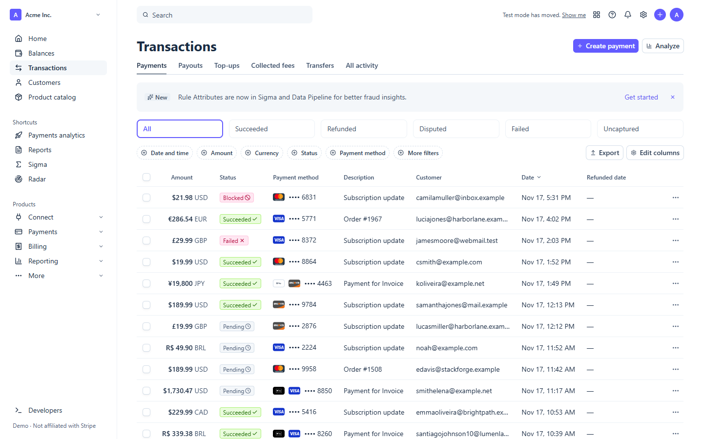
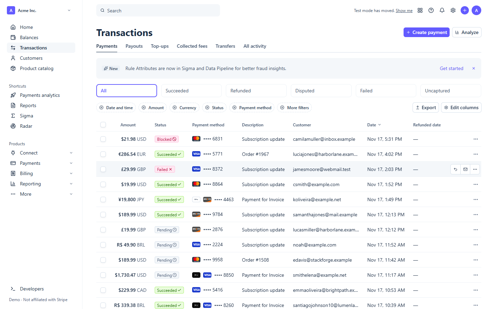
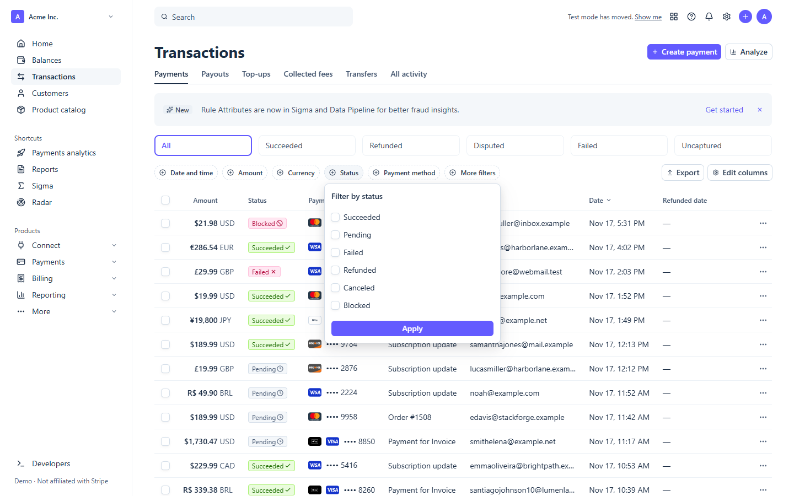

# Payments screen rebuild

A Next.js + TypeScript rebuild of the Stripe Dashboard "Transactions → Payments" screen, with 600 seeded mock payments, filtering, sorting, pagination, a details page, CSV export and a growth-analytics layer.

> Demo rebuild for a Chargeblast assessment. Not affiliated with Stripe.

[](https://github.com/franciscoPonceDev/chargeblast-stripe-payments/actions/workflows/ci.yml)

- **Live:** <https://chargeblast-stripe-payments.vercel.app/payments>
- **Repo:** <https://github.com/franciscoPonceDev/chargeblast-stripe-payments>

## Highlights

- **Measured, not eyeballed.** Spacing, colors, type and shadows come from a computed-style capture of the live Stripe dashboard, stored as design tokens. [See the evidence](#fidelity-method).
- **Shared links render correctly before any JavaScript.** The server renders the exact filtered page; after that, filtering, sorting and paging run in the browser with zero server round trips.
- **Fast.** Desktop Lighthouse 99-100, layout shift ~0, desktop LCP under 0.3 s. 142 KB of HTML cut by drawing card logos once per page.
- **Growth-ready analytics.** Typed events into GTM with Consent Mode v2, optional server-side tagging and PostHog, Web Vitals, and a flicker-free A/B test. No personal data in any event.
- **Tested end to end.** 330 unit tests, 24 Playwright tests with axe accessibility scans, visual regression, and CI that fails on a Lighthouse budget.

## Review this in 5 minutes

1. **A shared link with filters:** [failed + refunded, last 30 days, largest first](https://chargeblast-stripe-payments.vercel.app/payments?status=failed,refunded&date=30d&sort=amount.desc). Reload it: the first paint is already correct.
2. **Play with it:** type in search, change filters and sorting, switch to 100 rows, export CSV, hover a date.
3. **A details page:** click any row, or open [this payment](https://chargeblast-stripe-payments.vercel.app/payments/pi_mkRkv0n70L5jxRt7Zw4lVYHB).
4. **The quality gates:** the latest [CI run](https://github.com/franciscoPonceDev/chargeblast-stripe-payments/actions/workflows/ci.yml) (lint, types, unit, build, e2e, Lighthouse).
5. **The thinking:** [Judgment calls](#judgment-calls) and [Growth engineering](#growth-engineering).

## Screenshots

These are this app's own committed visual-regression baselines (1440x900, Windows Chrome).

| Default view | Row hover (copy ID, row actions) |
| --- | --- |
|  |  |



The visual reference was the screenshots in the assessment brief, plus measurements of the live Stripe dashboard (see [Fidelity method](#fidelity-method)). No Stripe screenshots or assets are in this repo.

## Growth engineering

The role this was built for is growth engineering, so the app ships with the tracking layer a marketing team would actually use. Full event dictionary and setup steps: [`docs/analytics.md`](docs/analytics.md).

**How a marketer would use it**

- **Which filters do people actually use?** `filter_applied` (filter name + how many values) and `search_performed` (query length only) show where users look for payments, which tells product what to surface by default.
- **Where do they get stuck?** `page_changed`, `sort_changed` and `export_csv` (row count) reveal people paging deep or exporting to work in a spreadsheet instead of in the product.
- **Does the new banner copy convert?** The `banner_cta` experiment logs exposure (`experiment_viewed`, once per session) and conversion (`banner_cta_clicked`) per variant. Conversion rate = clicks / exposures per variant, read in GA4 or PostHog.
- **Is the page fast for real users?** `web_vitals` sends CLS, INP, LCP, FCP and TTFB from real sessions, not just lab scores.

**How it is built**

- **Typed event layer.** `track(name, params)` in [`lib/analytics/events.ts`](lib/analytics/events.ts) pushes to `window.dataLayer`. 13 typed events; params are counts and enums only, never search text, emails, names or payment ids.
- **GTM + Consent Mode v2.** [`Gtm.tsx`](components/analytics/Gtm.tsx) sets all consent signals to `denied` before the container loads. An "Analytics cookies" switch in the account menu sends `consent update`. Nothing loads unless `NEXT_PUBLIC_GTM_ID` is set.
- **Server-side tagging.** `NEXT_PUBLIC_GTM_SERVER_URL` points the loader at your own tagging server (first-party, ad-blocker resilient).
- **PostHog adapter.** [`posthog.ts`](lib/analytics/posthog.ts): loaded on demand, opted out by default, no autocapture or session recording, enabled by the same consent switch.
- **Flicker-free A/B test.** [`middleware.ts`](middleware.ts) assigns a sticky 50/50 `ab_banner` cookie before the page renders, so the server already shows the right copy ("Get started" vs "Explore Sigma"). No client-side swap, no flash.

## Requirements checklist

### Required

| Requirement | Status | Where |
| --- | --- | --- |
| Payment ID, shortened, with copy button | Done | [`columns.tsx`](components/payments/columns.tsx), [`CopyIdButton.tsx`](components/payments/CopyIdButton.tsx) |
| Customer | Done | [`columns.tsx`](components/payments/columns.tsx) |
| Amount with currency | Done (USD, GBP, EUR, BRL, CAD, JPY; JPY zero-decimal) | [`lib/format.ts`](lib/format.ts) |
| Status badge | Done | [`StatusBadge.tsx`](components/payments/StatusBadge.tsx) |
| Payment method: brand + last 4 | Done (card brands, ACH, wallets) | [`PaymentMethodCell.tsx`](components/payments/PaymentMethodCell.tsx), [`BrandMark.tsx`](components/payments/BrandMark.tsx) |
| Created, with relative-time tooltip | Done | [`CreatedCell.tsx`](components/payments/CreatedCell.tsx), [`RelativeTime.tsx`](components/payments/RelativeTime.tsx) |
| Sorting by date, amount, status | Done (click cycles desc, asc, default; shift-click for multi-sort) | [`SortHeader.tsx`](components/payments/SortHeader.tsx), [`lib/payments/query.ts`](lib/payments/query.ts) |
| Pagination 25 / 50 / 100 | Done | [`PageSizeSelect.tsx`](components/payments/PageSizeSelect.tsx), [`TableFooter.tsx`](components/payments/TableFooter.tsx) |
| Date filter: Today, Last 7 days, Last 30 days, Custom | Done | [`DateFilterPopover.tsx`](components/payments/filters/DateFilterPopover.tsx) |
| Status filter (multi-select) | Done | [`StatusFilterPopover.tsx`](components/payments/filters/StatusFilterPopover.tsx) |
| Payment method filter (multi-select) | Done | [`MultiSelectFilter.tsx`](components/payments/filters/MultiSelectFilter.tsx) |
| Amount range filter | Done (any / equals / over / under / between) | [`AmountFilterPopover.tsx`](components/payments/filters/AmountFilterPopover.tsx) |
| Search by payment ID, email, last 4 | Done (also matches customer name) | [`SearchInput.tsx`](components/payments/filters/SearchInput.tsx), [`query.ts`](lib/payments/query.ts) |
| Mock data, 600 rows, seeded | Done, deterministic | [`generate.ts`](lib/payments/generate.ts), [`data/payments.json`](data/payments.json) (`npm run generate:data`) |

### Nice-to-have

| Item | Status | Where |
| --- | --- | --- |
| Sidebar and top bar | Done | [`components/shell/`](components/shell) |
| Payment details page | Done, statically generated for all 600 ids, with timeline | [`app/payments/[id]`](app/payments/%5Bid%5D), [`PaymentDetails.tsx`](components/payments/PaymentDetails.tsx) |
| Filters persisted in the URL | Done, shareable, rendered correctly on the server | [`lib/payments/url.ts`](lib/payments/url.ts) |
| CSV export | Done (exports the filtered set; module loaded on click) | [`csv.ts`](lib/payments/csv.ts), [`ExportButton.tsx`](components/payments/ExportButton.tsx) |
| Edit columns (visibility, wrap) | Done, saved in `localStorage` | [`EditColumns.tsx`](components/payments/EditColumns.tsx), [`tableSettings.ts`](lib/payments/tableSettings.ts) |
| Column resize / reorder | **Not done** | see [Not done](#not-done-and-next-steps) |

## Run and test

Node 22 or newer (CI uses 22; development used 24). No environment variables are required.

```bash
npm ci
npm run dev            # http://localhost:3000/payments (Turbopack)
npm run build && npm start
npm run lint && npm run typecheck
npm run test:run       # unit and component tests (Vitest, jsdom)
npm run test:e2e       # Playwright e2e + axe, builds and serves on :3100
npm run test:visual    # visual regression, local only (see below)
npm run lhci           # Lighthouse CI against a production build (needs `npm run build` first)
```

- **Visual baselines** are committed for `win32` only. Fonts and rendering differ per OS, so CI runs the `chromium` project and skips `visual`. Run `npm run test:visual` on Windows, or regenerate with `--update-snapshots` elsewhere.
- Local e2e uses the installed Chrome (`channel: "chrome"`); CI installs Playwright Chromium.

### Environment variables (all optional)

| Variable | Effect | Default |
| --- | --- | --- |
| `NEXT_PUBLIC_ALLOW_INDEXING` | `true` allows indexing (robots, sitemap, no `X-Robots-Tag`) | off (noindex) |
| `NEXT_PUBLIC_SITE_URL` | Absolute origin for canonical, OG and sitemap URLs | `VERCEL_PROJECT_PRODUCTION_URL`, then the live URL |
| `NEXT_PUBLIC_GTM_ID` | Loads Google Tag Manager with Consent Mode v2 | not loaded |
| `NEXT_PUBLIC_GTM_SERVER_URL` | Server-side tagging origin for the GTM loader | Google's loader |
| `NEXT_PUBLIC_POSTHOG_KEY` | Enables the consent-gated PostHog adapter | not loaded |
| `NEXT_PUBLIC_POSTHOG_HOST` | PostHog ingest host | `https://us.i.posthog.com` |

## Architecture

```
Request /payments?status=failed&sort=amount.desc
  -> middleware.ts            assigns sticky A/B cookie (ab_banner)
  -> Server Component         parseQuery(searchParams) -> applyQuery(600 rows) -> serialize ONLY the first page
  -> HTML renders the right first page (shared links look correct before any JS)
  -> after hydration          fetch /api/payments?v=<content hash>  (full dataset, CDN-cached)
  -> client filtering         same pure applyQuery, URL kept in sync via history.replaceState (no server round trips)
```

- **Server-first render.** [`app/payments/page.tsx`](app/payments/page.tsx) runs the shared query engine for the URL's query and passes just that page plus tab counts to the client. This makes `/payments` dynamically rendered (see trade-offs).
- **Full dataset after hydration.** [`PaymentsView.tsx`](components/payments/PaymentsView.tsx) fetches [`/api/payments?v=hash`](app/api/payments/route.ts) once. The URL is content-versioned and served with `s-maxage` and `stale-while-revalidate`. When it lands, filtering, sorting and paging run locally in [`usePaymentsQuery.ts`](lib/payments/usePaymentsQuery.ts) and are instant.
- **One query engine.** [`lib/payments/query.ts`](lib/payments/query.ts) is pure and shared by server and client, so both produce identical results.
- **URL state.** Tab, search, status, method, currency, date, amount, sort, page and page size are parsed and serialized in [`url.ts`](lib/payments/url.ts). Invalid params fall back to defaults per field.
- **Deterministic time.** The app timezone is fixed to UTC ([`lib/time.ts`](lib/time.ts)) and "now" is a fixed `MOCK_NOW` (2026-11-17 18:00 UTC), so SSR and client output match, and the "Today" filter and tests are stable.
- **Deterministic data.** A seeded mulberry32 generator ([`generate.ts`](lib/payments/generate.ts), seed 42) produced the committed `data/payments.json`.

| Path | Contents |
| --- | --- |
| `app/` | Routes: `/payments`, `/payments/[id]`, `/api/payments`, OG images, sitemap, robots, manifest |
| `components/payments/` | Table, cells, filters, banner, details |
| `components/shell/` | Sidebar, top bar, app shell |
| `components/ui/` | Button, Popover, Tooltip, Checkbox, Icon primitives |
| `components/analytics/`, `components/seo/` | GTM, Web Vitals, JSON-LD |
| `lib/payments/` | Types, generator, query engine, URL codec, CSV, table settings |
| `lib/analytics/` | Typed event layer, consent, PostHog adapter, exposure |
| `e2e/` | Playwright functional, axe and visual specs |
| `docs/` | Measurements, tokens, analytics, performance |

## Fidelity method

1. **Layout, labels and structure** come from the screenshots in the assessment brief.
2. **Values** (font sizes, colors, spacing, borders, shadows, focus ring) come from a computed-style capture of the live Stripe dashboard, recorded in [`docs/stripe-measurements.md`](docs/stripe-measurements.md) and [`docs/stripe-tokens.md`](docs/stripe-tokens.md) and applied as design tokens in [`app/globals.css`](app/globals.css).
3. **Where the brief and the live dashboard disagree**, the brief wins when the difference is visible (for example the selected status card styling and pill rounding), and the choice is recorded below.
4. **Assets are open-license**: Lucide icons (ISC), card brand marks (Apache-2.0/MIT), Apple Pay and Google Pay glyphs from simple-icons (CC0). No Stripe artwork was copied. See [`THIRD_PARTY_NOTICES.md`](THIRD_PARTY_NOTICES.md).
5. **Brand color** is `#635bff`, as rendered in the brief. The live dashboard has since moved to `#533afd`.

A sample of measured values and where they live in this app:

| Element | Measured on live Stripe | This app |
| --- | --- | --- |
| Table row | 44px high, 1px `#ecf1f6` divider | 44px (`h-11`), `--color-border-row: #ecf1f6` |
| Body text | 14px / 20px, `#1a2c44` | `--color-text-primary: #1a2c44` |
| Succeeded badge | 12px / 16px, padding 1px 6px, radius 4, `#eafcdd` / `#a8f170` / `#217005` | same values in [`StatusBadge.tsx`](components/payments/StatusBadge.tsx) and tokens |
| Buttons | 28px high, radius 6, ring `0 0 0 1px #d4dee9` | `--shadow-ring: 0 0 0 1px #d4dee9` |
| Focus ring | `0 0 0 4px rgba(1,150,237,.36)` | `--shadow-focus`, identical |

## Judgment calls

The decisions that mattered most, and why.

- **Brief over live Stripe when they disagree.** Stripe has redesigned this page since the brief was written. Reviewers compare against the brief, so its layout and labels win, while the precise values (spacing, colors, shadows) come from live measurements.
- **Search engines are blocked on purpose.** A public page that looks like the Stripe dashboard can get flagged by phishing classifiers, which can get the domain blocked in browsers. Full SEO is built (metadata, OG images, sitemap, JSON-LD) and turns on with one env var.
- **Amounts sort by real value, not face value.** Without conversion, ¥49,800 (about $330) sorts above $4,999. Sorting uses a fixed USD exchange table; the amount filter stays in each payment's own currency, which is what a user typing "over 100" expects.
- **Server-first, then client-only.** The server renders the exact page a shared link asks for, so it is right before any JavaScript runs. After that, the full dataset loads once and every interaction is local, with no request per keystroke.
- **Clean, privacy-safe mock data.** A final review found that a real company's email domain had slipped into the generated data. It was replaced with reserved test domains, with every payment otherwise unchanged, and removed from the git history too.
- **The Payment ID column sits last.** The brief requires it but the reference screenshot does not show it, so placing it last keeps every other column exactly where the reference has it.

## All decisions and trade-offs

Product and fidelity:

- Added a visible "Status" column header (Stripe leaves it blank) so the column is sortable. One label difference from the reference.
- Column order follows the brief's positions; the required Payment ID column sits last, before actions, so nothing shifts.
- Brand purple stays `#635bff` (brief) rather than live `#533afd`. Brand text on subtle backgrounds is darkened to pass 4.5:1 (`#635bff` is 4.37:1 on `#f4f7fa`).
- Brief wins over live Stripe for the selected status card, lighter filter pills and fully rounded pills.
- Card and wallet marks are open-license glyphs or simple chips, not trademarked artwork. Link has no open mark, so it is a neutral placeholder chip.
- Status tabs show labels only, no counts, as in the reference.
- The table scrolls horizontally beside the sidebar, as the reference does, rather than wrapping columns.
- Search has two entry points (top bar and "More filters"), both bound to one query value.
- "Edit columns" opens a Table-settings-style panel with column visibility; settings are a per-browser preference in `localStorage`, not URL state.
- Sort cycle is desc, asc, default; shift-click adds a sort.
- Amount sort compares a USD-normalised value using a small fixed FX table (illustrative rates, not live), so JPY rows do not dominate; the amount filter stays in each payment's own major units.
- Search also matches customer name; invalid amount or date inputs degrade to "no filter"; `between` with min over max swaps.
- Detail-page fees use an illustrative model (2.9% + 30c; zero-decimal currencies 3.6%), not Stripe's real pricing.

Engineering:

- **UTC everywhere.** Identical SSR and client output and filter bounds, but times show in UTC rather than the viewer's zone.
- **Fixed `MOCK_NOW`.** Deterministic data and tests, but the dataset never rolls forward.
- **Dynamic `/payments`.** Reading `searchParams` gives a correct first paint for shared links at the cost of prerendered HTML. Data is in memory, so TTFB stays low.
- **Full dataset fetched after hydration.** Small first load and instant filtering, at the cost of a late fetch. The `?v=` URL is cached hard at the CDN while browsers keep revalidating (`max-age=0`).
- **Saved table settings** are read after mount so SSR matches the first client render. A tiny inline pre-paint script applies them to avoid layout shift, which requires CSP `'unsafe-inline'`.
- **Copy button** appears on hover or focus (desktop-first); touch users reach it via focus only.
- **CSV download** revokes its object URL after a delay because some browsers start the download asynchronously. The CSV module loads on click, so the first export has a tiny delay.
- **Invalid URL params** fall back to defaults per field; a bad link never breaks the page but fails silently.
- **Analytics:** consent is denied by default and read after mount so SSR and first paint are identical. Event params are counts and enums only. `web-vitals`, `posthog-js` and GTM load on demand after hydration.
- **OG images use system fonts** to avoid a build-time font fetch, at the cost of exact typography.
- **Empty sitemap and noindex while indexing is off.**
- **`htmlLimitedBots: /.*/`** keeps metadata in `<head>` for every user agent; revisit if metadata gains I/O.
- **Page-level integration tests have a 30s timeout** (heavy jsdom renders); real-browser e2e covers the same flows.
- Process rulings: Stripe REST via `fetch` and no `stripe` dependency for the data-seeding spike; TanStack Table pinned to v8 (the plan and interfaces assume the v8 API); focus ring adopts Stripe's measured `0 0 0 4px rgba(1,150,237,.36)`.

## Performance

Method: production build, Lighthouse CLI with simulated throttling, median of 3 runs, before (`83373e0`) vs after. Full data and the run-to-run spread are in [`docs/perf/results.md`](docs/perf/results.md) and [`docs/perf/baseline.md`](docs/perf/baseline.md).

| Metric | Before | After |
| --- | --- | --- |
| `/payments` first-load JS | 202 kB | **196 kB** |
| `/payments` HTML document (raw) | 315 KB | 287 KB |
| `/payments` mobile Performance | 75 | **78** |
| `/payments` mobile TBT | 1322 ms | 993 ms |
| `/payments` mobile LCP | 934 ms | 1098 ms |
| `/payments` desktop Performance | 99 | **100** |
| `/payments` desktop CLS | 0 | 0.002 |
| `/payments/[id]` mobile / desktop Performance | 87 / 100 | 85 / 100 |

**The mobile Lighthouse Performance target (95) was not met**: 78 for the list, 85 for the details page. The test machine scored below Lighthouse's reference device, so mobile numbers are pessimistic. More importantly, under 4x CPU throttle the React and Next runtime alone (about 100 kB gzip) costs roughly 500 ms of TBT, and even the static details page, with almost nothing on it, lands at 85-89. Mobile TBT also varies by about 300 ms between runs, so small mobile deltas (including LCP going up) are noise. Desktop meets 95 (99-100), LCP is under 1.5 s everywhere, and CLS is 0-0.002.

What moved the numbers:

- Card brand sprite rendered once on the server and referenced with `<use>`, instead of per-row inline SVG (document 315 to 287 KB, about 1,500 fewer SVG nodes, card-icon library out of the client bundle).
- No `Intl` on the render path: amounts, dates and footer totals are plain string building, tested against `Intl` and `date-fns` for every currency (about 200 ms less main-thread time in a throttled profile).
- Lazy relative-time tooltip content, hover-only route prefetch, and stable server result identity when the full dataset lands.
- Zero layout shift for saved table settings via the pre-paint script.
- CSV export, web-vitals, posthog-js and GTM are all outside every first-load chunk.

Tried and not kept: `content-visibility` on rows (no effect), lazy popover bodies (about 3 kB gzip, not worth a request), `useDeferredValue` for search (query is sub-millisecond).

## SEO and indexing

- Metadata, canonical URLs, Open Graph and Twitter cards on both routes. Generated OG images for the site and list ([`app/opengraph-image.tsx`](app/opengraph-image.tsx), [`app/payments/opengraph-image.tsx`](app/payments/opengraph-image.tsx)) and each payment ([`app/payments/[id]/opengraph-image.tsx`](app/payments/%5Bid%5D/opengraph-image.tsx)).
- [`robots.ts`](app/robots.ts), [`sitemap.ts`](app/sitemap.ts) (list plus 600 detail URLs), a web manifest, and breadcrumb JSON-LD on detail pages ([`JsonLd.tsx`](components/seo/JsonLd.tsx)).
- **Indexing is blocked by default**: `robots.txt` disallows all, the sitemap is empty, and every response carries `X-Robots-Tag: noindex, nofollow`. A public page that looks like the Stripe dashboard risks phishing-classifier flags, so it is opt-in. The page also states it is not affiliated with Stripe.
- To enable: set `NEXT_PUBLIC_ALLOW_INDEXING=true` (and `NEXT_PUBLIC_SITE_URL` if the domain differs) at build time and redeploy.

## Security

[`lib/securityHeaders.ts`](lib/securityHeaders.ts), applied to every route from [`next.config.ts`](next.config.ts):

- Content-Security-Policy: `default-src 'self'`, `object-src 'none'`, `base-uri 'self'`, `form-action 'self'`, `frame-ancestors 'none'`. GTM and PostHog origins are added only when configured; origins from env vars are validated so a value cannot inject a new directive.
- `Referrer-Policy: strict-origin-when-cross-origin`, `X-Content-Type-Options: nosniff`, a restrictive `Permissions-Policy`, and HSTS in production only.
- **`script-src` includes `'unsafe-inline'`, deliberately.** Next's inline bootstrap and flight scripts differ per request, and `/payments/[id]` is prerendered, so a per-request nonce or build-time hashes cannot cover every route. The pre-paint settings script also needs it. Every other directive stays strict. The measured result is no CSP violations in the console with or without GTM configured.

## Quality gates

| Gate | Count / threshold | Runs where |
| --- | --- | --- |
| Unit and component tests (Vitest) | 330 passing | CI, local |
| Playwright e2e | 24 (21 functional + 3 axe accessibility) | CI, local |
| Visual regression | 3 baselines (win32) | Local only |
| Lint, typecheck, production build | must pass | CI |
| Lighthouse CI (desktop preset, 3 runs) | Performance >= 95, Accessibility >= 95, Best practices >= 90, CLS <= 0.02, LCP <= 1.5 s; SEO >= 90 warns | CI |

CI ([`.github/workflows/ci.yml`](.github/workflows/ci.yml)) runs on pushes and PRs to `main` and `feat/**`, and uploads the Playwright report on failure and the Lighthouse results always. LHCI uses the desktop preset because the mobile target is not met (see Performance).

## AI-assisted workflow

I used AI agents (Claude Code) the way I would run a small team:

- **I set the direction.** I shaped and approved the spec and the plan, chose the fidelity source (brief layout plus live measurements), required open-license icons only, and decided to keep indexing off.
- **I set the quality bar.** Every task had to pass tests and an independent code review before the next one started, and the whole branch got a final senior-level review before merging. Review findings were fixed, not waived.
- **Agents did the typing.** Implementation agents wrote code against that plan; a progress ledger recorded every ruling so decisions stayed consistent.

The result is more ground covered in the time available, with every change still reviewed and tested.

## Roadmap

What I would do next, in order:

1. **Column resize and reorder** (the one nice-to-have not built): TanStack `columnOrder` with drag handles, `columnSizing` with keyboard support.
2. **Mobile performance to 95+** (currently 78): cut hydration cost by making filters separate islands and rendering the first page with no client JS until interaction.
3. **Visual regression in CI** by adding Linux baselines next to the Windows ones.
4. **Server-side pagination** so the design scales past datasets that fit in the browser.
5. **Real time handling:** a timezone selector instead of fixed UTC, and data relative to today.
6. **Touch-friendly row actions** (copy is hover/focus only today) and a **nonce-based CSP** if the details pages stop being prerendered.
